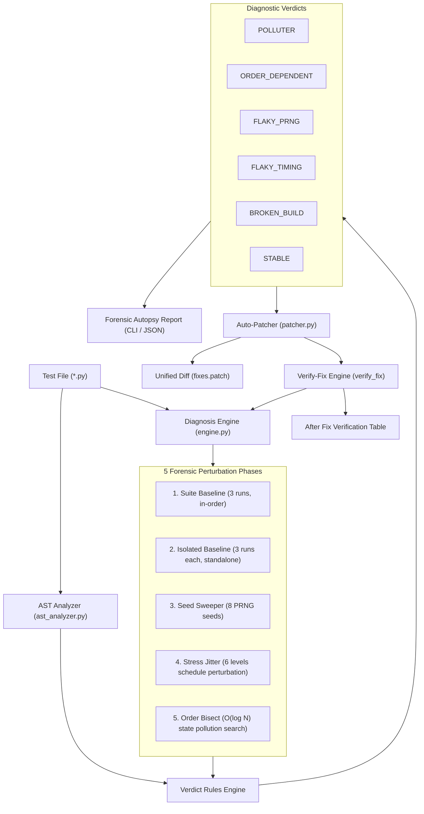

# Flake Doctor Architecture

Flake Doctor is an autonomous root-cause diagnosis engine and AST auto-patcher for non-deterministic pytest test suites.

## Forensic Pipeline Overview

1. **AST Analyzer**: Performs static single-pass inspection of test function ASTs for `UNSEEDED_PRNG`, `TIMING_RACE`, `CLOCK_DEPENDENCY`, and `STATE_POLLUTION`.
2. **Suite Baseline**: Runs the test suite 3 times in original order with a deterministic baseline seed (`PASS_SEED`) to establish a ground-truth pass rate.
3. **Isolated Baseline**: Runs each test independently 3 times in an isolated subprocess to detect order dependency and isolation failures.
4. **Order Bisection**: If a test passes in suite order but fails in isolation, performs binary search bisection across preceding tests to pinpoint the exact culprit test polluting state.
5. **Seed Sweeper**: Runs suite across 8 deterministic PRNG seeds to measure variance and identify seed-dependent thresholds.
6. **Stress Jitter Sweep**: Injects thread scheduling contention and delay perturbations into worker threads to reveal race conditions.
7. **Statistical Confidence**: Computes required clean consecutive runs $N = \lceil \ln(0.01) / \ln(1 - p) \rceil$ to achieve 99% confidence.
8. **Auto-Patcher & Closed Loop Verification**: Transforms flaky patterns via AST-guided rewriting (`monkeypatch`, seeding, synchronization) and proves fixes pass clean runs without mutating original files.
